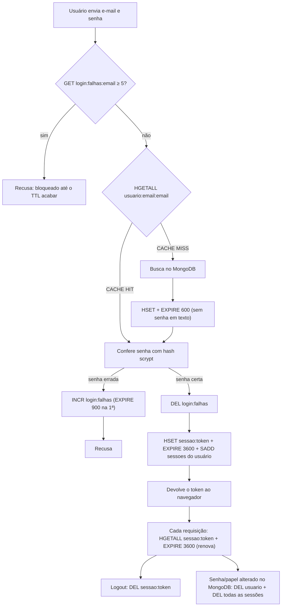

# Atividade A3 — Redis no Consentio (guia de defesa)

Este guia explica **cada decisão e cada comando** da A3, para responder qualquer pergunta na apresentação.

- **Parte 1:** cache de login de usuário
- **Parte 2:** estatísticas de uso com estruturas probabilísticas (Bloom Filter, HyperLogLog, Count-Min Sketch)

---

## 0. Por que Redis no Consentio

O MongoDB continua sendo o **banco principal** (fonte da verdade). O Redis entra como uma **camada em memória** na frente dele, para duas coisas que o MongoDB faz mal ou caro:

| Necessidade | Por que Redis |
|---|---|
| Validar o login e a sessão em **toda** requisição | Leitura em memória (< 1 ms) em vez de ida ao Atlas pela rede (dezenas de ms) |
| Expirar sessões e bloqueios sozinho | **TTL** nativo por chave: o Redis apaga quando o tempo acaba |
| Contar usuários únicos, eventos e "já existe?" em grande volume | Estruturas probabilísticas: memória **fixa e mínima** com erro pequeno e conhecido |

Redis é um banco NoSQL do tipo **chave-valor**: cada dado é acessado por uma chave, e o valor pode ser uma estrutura (String, Hash, Set, Bitmap, HyperLogLog...). Tudo fica na RAM, por isso é rápido; em troca, a memória é cara e limitada, e por isso TTL e estruturas compactas importam tanto.

**Padrão de nomes das chaves:** `consentio:<área>:<identificador>` (ex.: `consentio:sessao:<token>`). Os dois-pontos são convenção do Redis para organizar chaves em "pastas", e o prefixo evita colisão com outros sistemas no mesmo Redis.

---

## 1. Cache de login de usuário

### 1.1 Fluxo completo



### 1.2 Chaves usadas

| Chave | Tipo | Conteúdo | TTL | Por quê |
|---|---|---|---|---|
| `consentio:usuario:email:<email>` | **Hash** | id, nome, papel, clinica_id, ativo, **senha_hash** | 10 min | Evita ir ao MongoDB a cada login |
| `consentio:sessao:<token>` | **Hash** | usuario_id, nome, papel, clinica_id, permissões, ip, criada_em | 1 h, renovada a cada uso | Quem está logado, sem consultar o banco |
| `consentio:usuario:<id>:sessoes` | **Set** | tokens ativos do usuário | 1 h | Permite derrubar todas as sessões de uma vez |
| `consentio:login:falhas:<email>` | **String** (contador) | número de senhas erradas | 15 min | Bloqueio contra força bruta |

**Por que Hash e não String com JSON?** No Hash cada campo é acessível sozinho (`HGET sessao:x papel`) e dá para mudar um campo sem reescrever tudo. Com JSON numa String seria preciso ler, decodificar, alterar e regravar.

### 1.3 Segurança

1. **A senha nunca é guardada em texto puro**, nem no MongoDB nem no Redis. Guarda-se `scrypt$<salt>$<hash>`.
   - **scrypt** é uma função de hash *lenta de propósito* e que usa muita memória, o que encarece ataques de força bruta (mesma família de bcrypt e Argon2). É nativa do Node, então não precisa de biblioteca extra.
   - **salt** aleatório por usuário: duas pessoas com a mesma senha têm hashes diferentes, e tabelas prontas (*rainbow tables*) não funcionam.
   - `timingSafeEqual`: compara em tempo constante, para que o tempo de resposta não revele quantos caracteres batem.
2. **Token de sessão** com `crypto.randomBytes(32)`, ou seja, 256 bits aleatórios: impossível de adivinhar.
3. **Mensagem de erro igual** para e-mail inexistente e para senha errada, para não revelar quais e-mails estão cadastrados.
4. **Limite de tentativas:** 5 erros em 15 min bloqueiam o e-mail até o TTL acabar.
5. **Invalidação:** ao trocar a senha ou o papel no MongoDB, o cache e as sessões são apagados na hora, e o usuário precisa logar de novo com os dados novos.
6. **Em produção:** Redis com senha (`requirepass`/ACL), TLS e sem acesso público. O Redis Cloud já exige senha.

### 1.4 Explicação linha por linha (`src/cache_login.js`)

**Constantes**
```js
const TTL_USUARIO = 10 * 60;   // 600 s
const TTL_SESSAO  = 60 * 60;   // 3600 s
const TTL_BLOQUEIO = 15 * 60;  // 900 s
const MAX_TENTATIVAS = 5;
```
- **TTL do usuário (10 min) curto:** limita quanto tempo um dado desatualizado pode ficar no cache. Se a invalidação falhar, em no máximo 10 min o Redis busca de novo no MongoDB.
- **TTL da sessão (1 h):** a sessão parada por 1 hora expira sozinha. Como é renovada a cada uso, quem está trabalhando não cai.

**`obterUsuario()`: padrão cache-aside**
```js
const emCache = await client.hGetAll(chave);          // HGETALL
if (Object.keys(emCache).length > 0) return ...HIT
const doBanco = await buscarUsuarioPorEmail(email);   // MongoDB
await client.multi().hSet(chave, paraCache).expire(chave, TTL_USUARIO).exec();
```
- `HGETALL` devolve todos os campos do Hash. Se a chave não existe, devolve vazio: é o **cache miss**.
- No miss, a aplicação busca no MongoDB e **ela mesma** grava no Redis. Por isso se chama *cache-aside*: o cache fica "ao lado" e quem controla é a aplicação.
- `MULTI ... EXEC` executa `HSET` e `EXPIRE` juntos e de forma **atômica**. Sem isso, se o processo caísse entre os dois comandos, a chave ficaria sem TTL para sempre.
- `paraCache` copia só os campos necessários: não grava endereço, CPF etc., porque o mínimo de dados pessoais em cache é bom para a LGPD.

**`login()`**
```js
const falhas = Number(await client.get(k.falhas(email))) || 0;
if (falhas >= MAX_TENTATIVAS) { const resta = await client.ttl(...); return bloqueado }
```
- `GET` lê o contador. Se ele não existe, devolve `null`, que vira 0.
- `TTL` devolve quantos segundos faltam para a chave expirar e é usado para avisar "bloqueado por X s".

```js
if (!usuario || usuario.ativo !== "true" || !conferirSenha(senha, usuario.senha_hash)) {
  const n = await client.incr(k.falhas(email));                  // INCR
  if (n === 1) await client.expire(k.falhas(email), TTL_BLOQUEIO);
```
- `INCR` soma 1 de forma atômica: dois logins errados simultâneos não se perdem. Se a chave não existe, ela é criada com 1.
- O `EXPIRE` só roda quando `n === 1`. Assim a janela de 15 min começa no **primeiro** erro e não é empurrada a cada nova tentativa.
- No Redis todo valor é texto, por isso `ativo` é comparado com `"true"`.

```js
await client.del(k.falhas(email));                   // sucesso zera o contador
const token = crypto.randomBytes(32).toString("hex");
await client.multi()
  .hSet(k.sessao(token), sessao).expire(k.sessao(token), TTL_SESSAO)
  .sAdd(k.sessoesDoUsuario(usuario.id), token).expire(..., TTL_SESSAO)
  .exec();
```
- A sessão guarda papel, clínica e **permissões**. Assim, as próximas requisições já sabem o que o usuário pode fazer sem consultar o MongoDB.
- `SADD` registra o token no conjunto de sessões do usuário. Um Set não aceita repetidos, e isso permite o "sair de todos os dispositivos".

**`validarSessao()`: chamada em toda requisição**
```js
const sessao = await client.hGetAll(chave);
if (vazio) return null;                    // expirou ou fez logout → manda logar de novo
await client.expire(chave, TTL_SESSAO);    // expiração deslizante
```
- É aqui que o cache rende: a validação leva menos de 1 ms (no teste, 0,6 ms) contra cerca de 40 ms ou mais indo ao Atlas.

**`logout()`:** `DEL` apaga a sessão e `SREM` tira o token do Set.

**`invalidarUsuario()`**
```js
const tokens = await client.sMembers(k.sessoesDoUsuario(usuarioId));  // SMEMBERS
multi.del(usuario) + del(set) + del(cada sessão)
```
- `SMEMBERS` lista todos os tokens, e um único `MULTI` apaga tudo.
- Esse é o ponto de **consistência com o banco principal**: o MongoDB muda, então o cache é apagado.

### 1.5 Resultado da demo (`npm run login`)

| Situação | Tempo | Consultas ao MongoDB |
|---|---|---|
| 1º login (cache miss) | ~88 ms | 1 |
| Validar sessão | ~0,6 ms | 0 |
| 2º login (cache hit) | ~42 ms | 0 (continua 1) |

> O login com hit ainda leva cerca de 40 ms porque o **scrypt é lento de propósito**: é o custo de segurança da senha. O ganho do cache está em não ir ao banco e em validar a sessão em toda requisição em menos de 1 ms.

---

## 2. Estatísticas de uso com estruturas probabilísticas

### 2.0 Ideia geral

Estruturas probabilísticas **trocam um pouco de precisão por muito menos memória e tempo constante**. O erro é **pequeno, conhecido e ajustável**.

| Estrutura | Pergunta que responde | Erro possível | Memória |
|---|---|---|---|
| **Bloom Filter** | "Este item já existe?" | Falso **positivo** (diz "talvez sim" quando não existe). **Nunca** falso negativo | ~1,2 byte por item com 1% de erro |
| **HyperLogLog** | "Quantos itens **únicos**?" | ±0,81% (erro padrão) | Máximo 12 KB, para qualquer quantidade |
| **Count-Min Sketch** | "Quantas vezes este item apareceu?" | Só **superestima**, nunca subestima | largura × profundidade contadores (fixo) |

**Dois modos de execução (o código detecta sozinho):**
- **Nativo:** com o módulo **RedisBloom** (Redis 8, Redis Stack, Redis Cloud), usa `BF.*` e `CMS.*`.
- **Implementação própria:** num Redis sem o módulo, usa o **mesmo algoritmo** montado com comandos básicos (`SETBIT`/`GETBIT` para o Bloom e `HINCRBY` para o CMS). Serve também para mostrar como as estruturas funcionam por dentro.
- O **HyperLogLog** é nativo em qualquer Redis (`PFADD`/`PFCOUNT`/`PFMERGE`).

### 2.1 Bloom Filter

**Uso no Consentio**
- **E-mail no cadastro de usuário:** antes de consultar o MongoDB, pergunta ao Bloom. "Não existe" é **certeza**, e o cadastro segue sem ir ao banco. "Talvez exista" leva a confirmar no MongoDB.
- **CPF por clínica:** a mesma ideia, antes de inserir um paciente.
- **Hash do documento gerado:** para saber se um termo com aquele conteúdo já foi emitido.

**Como funciona:** é um vetor de **m bits**, todos em 0, mais **k funções hash**.
- **Inserir:** calcula os k hashes do item e liga esses k bits.
- **Consultar:** se **algum** dos k bits estiver em 0, o item **com certeza não foi inserido**. Se **todos** estiverem em 1, ele **talvez** tenha sido inserido, porque outros itens podem ter ligado aqueles bits. Esse é o falso positivo.
- **Por que não existe falso negativo:** bits só são ligados, nunca desligados. Um item inserido sempre encontra seus k bits em 1.
- **Consequência:** o Bloom Filter padrão não permite remover itens (desligar um bit afetaria outros). Para isso existe o *Cuckoo Filter* (`CF.*`).

**Parâmetros** (`src/probabilisticas.js`, construtor):
```js
this.m = Math.ceil((-capacidade * Math.log(erro)) / Math.LN2 ** 2); // m = -n·ln(p) / (ln 2)²
this.k = Math.round((this.m / capacidade) * Math.LN2);             // k = (m/n)·ln 2
```
- Com n = 10.000 itens e p = 1%, ficam m = 95.851 bits (cerca de 12 KB) e k = 7 hashes.
- Menos erro exige mais bits. Com p = 0,1%, m dobra para 14,4 bits por item.
- Se inserir **mais** que a capacidade, o erro sobe. O `BF.RESERVE` nativo cria camadas extras automaticamente (*scaling*).

**Hashes:** `doisHashes()` tira 2 números do SHA-256 do item e gera os k hashes com `h1 + i·h2`. Essa técnica é o *double hashing* de Kirsch & Mitzenmacher, com qualidade equivalente a k hashes independentes.

**Comandos**

| Comando | O que faz |
|---|---|
| `BF.RESERVE chave 0.01 10000` | Cria o filtro com 1% de erro para 10 mil itens |
| `BF.ADD` / `BF.MADD chave itens...` | Insere um ou vários itens |
| `BF.EXISTS` / `BF.MEXISTS chave itens...` | Devolve 1 ("talvez existe") ou 0 ("não existe") |
| `SETBIT chave pos 1` / `GETBIT chave pos` | Versão manual: liga ou lê um bit do bitmap |

**Resultado da demo:** 10.000 e-mails inseridos, **0 falsos negativos** e **108 falsos positivos em 10.000 e-mails novos (1,08%, esperado ≈ 1%)**. Isso significa que 9.892 cadastros dispensaram a consulta ao MongoDB. O filtro inteiro ocupa **12 KB**.

### 2.2 HyperLogLog

**Uso no Consentio**
- `consentio:stats:hll:ativos:<data>`: usuários ativos únicos por dia.
- `PFMERGE` dos 7 dias dá os ativos únicos da semana. Somar os dias contaria a mesma pessoa várias vezes, e o merge resolve isso.
- `consentio:stats:hll:pacientes:<clinica>:<data>`: pacientes únicos atendidos ou visualizados por clínica.

**Como funciona (intuição):** o HLL calcula o hash de cada item e observa **quantos zeros seguidos** aparecem no começo do hash. Ver um hash que começa com 10 zeros é raro (chance de 1 em 1.024), então sugere que já passaram cerca de 1.024 itens diferentes. Para reduzir o erro, o Redis divide os itens em **16.384 registradores** e tira uma média harmônica.
- O mesmo item gera sempre o mesmo hash, por isso **repetidos não alteram a contagem**.
- O erro padrão é **1,04 / √16384 ≈ 0,81%**.
- A memória é de **no máximo 12 KB**, seja para 1 mil ou 1 bilhão de itens. Com poucos itens, o Redis usa uma representação esparsa ainda menor.
- **Limitação:** o HLL conta, mas não lista nem diz se um item específico está lá.

**Comandos**

| Comando | O que faz |
|---|---|
| `PFADD chave itens...` | Adiciona itens. Devolve 1 se a estimativa mudou |
| `PFCOUNT chave [chave...]` | Estimativa de únicos. Com várias chaves, conta a união |
| `PFMERGE destino origens...` | Grava a união de vários HLL numa chave nova |

**Resultado da demo:** os erros diários ficaram entre −0,77% e +1,01%, e a semana fechou em −0,70%. Para **100.000 pacientes**, o HLL usou **14 KB** com erro de 0,37%. Um **SET exato usou 5.442 KB**, cerca de **390 vezes mais memória**.

### 2.3 Count-Min Sketch

**Uso no Consentio**
- `consentio:stats:cms:eventos:<data>`: quantas vezes cada ação ocorreu no dia: `documento_gerado`, `ficha_aberta`, `odontograma_aberto`, `agenda_consultada`, `mapa_facial_aberto`, `login`.
- Itens com hora, como `documento_gerado@14h`, mostram o **horário de pico** de geração de termos e ajudam a dimensionar a infraestrutura.

**Como funciona:** é uma matriz de **d linhas × w colunas** de contadores, com uma função hash por linha.
- **Incrementar:** em cada linha, o hash do item escolhe uma coluna, e esse contador recebe +1.
- **Consultar:** lê o contador do item em cada linha e devolve o **menor**.
- **Por que só superestima:** itens diferentes podem cair no mesmo contador (colisão) e **somar**, mas nada subtrai. Cada contador é ≥ o valor real, e o menor deles é o menos contaminado.

**Parâmetros**
- **Largura w** controla o **tamanho do erro**: erro ≤ (e / w) × total de eventos. Com w = 2000, o erro fica em cerca de 0,14% do total.
- **Profundidade d** controla a **confiança**: probabilidade de acerto de 1 − e^(−d). Com d = 5, a confiança é de 99,3%.
- `CMS.INITBYPROB chave 0.001 0.01` calcula w e d sozinho a partir do erro (0,1%) e da probabilidade de falha (1%).

**Comandos**

| Comando | O que faz |
|---|---|
| `CMS.INITBYDIM chave 2000 5` | Cria com largura e profundidade |
| `CMS.INITBYPROB chave erro prob` | Cria a partir do erro desejado |
| `CMS.INCRBY chave item qtd [item qtd...]` | Incrementa |
| `CMS.QUERY chave itens...` | Estimativa da frequência |
| `HINCRBY chave "linha:coluna" qtd` / `HMGET` | Versão manual com Hash |

**Resultado da demo:** com 50.000 eventos e w = 2000, todas as estimativas bateram com o valor exato, porque há poucas ações diferentes para colidir. O pico de geração de termos ficou às **11h**. No CMS **minúsculo de propósito (w = 8, d = 2)**, `login@8h` deu 8.775 contra 181 reais. A superestimativa aparece, **sempre para cima**, e mostra por que a largura importa.

---

## 3. Trade-offs (perguntas prováveis)

**"E se o Redis cair?"**
O Redis é **cache**, não fonte da verdade. O login volta a consultar o MongoDB direto (mais lento, mas funciona). As sessões ativas se perdem e os usuários precisam logar de novo. Para evitar isso, há persistência (AOF/RDB) ou réplica. As estatísticas são aproximadas por natureza e podem ser recalculadas a partir da auditoria no MongoDB.

**"O cache pode ficar desatualizado?"**
Sim, por no máximo o TTL (10 min), se a invalidação falhar. Isso é **consistência eventual**. Para diminuir o risco, toda alteração de senha, papel ou status no MongoDB chama `invalidarUsuario()`. O TTL curto é a rede de segurança.

**"Por que guardar o hash da senha no Redis?"**
Para o login inteiro não depender do MongoDB. É o mesmo hash que já está no banco, nunca a senha. A alternativa mais conservadora é deixar o hash só no MongoDB e cachear apenas perfil e sessão. Isso custa uma consulta ao banco por login, mas a validação das requisições continua no Redis.

**"Por que TTL deslizante na sessão?"**
Quem está usando o sistema não é deslogado. Quem esquece o computador aberto na recepção perde a sessão após 1 h parada, o que é importante para dados de saúde.

**"Por que não usar KEYS para listar chaves?"**
`KEYS` percorre tudo de uma vez e **trava** o Redis, que executa um comando por vez. `SCAN` percorre em pedaços sem bloquear.

**"Por que MULTI?"**
Para que gravar e definir o TTL sejam atômicos. Nenhuma chave fica "eterna" por queda no meio da operação.

**"Por que estrutura probabilística e não contar exato no MongoDB?"**
Contar únicos exatos exige guardar todos os IDs (o SET de 100 mil pacientes ocupou 5,4 MB) ou fazer `distinct` pesado no banco a cada consulta do painel. O HLL responde em O(1) com 12 KB. Para um painel de uso, 1% de erro é irrelevante. Para cobrança ou dados clínicos, conta-se exato no MongoDB.

**"Quando NÃO usar cada uma?"**
- **Bloom:** quando é preciso remover itens (usar Cuckoo Filter) ou quando um falso positivo sem confirmação causaria dano.
- **HLL:** quando é preciso a lista dos itens, não só a contagem.
- **CMS:** quando é preciso a lista dos mais frequentes sem saber os nomes antes (usar Top-K, `TOPK.*`).

**"Memória x precisão em números"**

| Estrutura | Configuração | Memória | Erro |
|---|---|---|---|
| Bloom | 10 mil itens, 1% | 12 KB | 1,08% de falso positivo medido |
| HLL | 100 mil únicos | 14 KB | 0,37% medido |
| SET exato | 100 mil únicos | 5.442 KB | 0% |
| CMS | 2000 × 5 | ~40 KB nativo (3,6 KB na versão própria, que só grava contadores usados) | 0 no teste |

---

## 4. Glossário rápido

- **Cache hit / miss:** o dado foi ou não encontrado no Redis.
- **Cache-aside:** a aplicação lê do cache e, no miss, busca no banco e grava no cache.
- **TTL (Time To Live):** segundos até a chave ser apagada sozinha. `EXPIRE` define, `TTL` consulta.
- **Hash (Redis):** chave com vários campos e valores, como um pequeno documento.
- **Set:** conjunto sem repetidos.
- **Bitmap:** String tratada como vetor de bits (`SETBIT`/`GETBIT`/`BITCOUNT`).
- **Atômico:** acontece por inteiro ou não acontece.
- **Falso positivo:** a estrutura diz "sim" quando a resposta real é "não".
- **Consistência eventual:** cópias podem ficar diferentes por um tempo, mas convergem.
